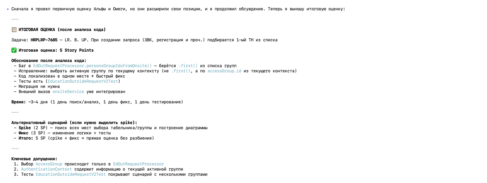

# Грумминг сессия агентов для получения более точных оценок

## Описание
Скилл выступает как скрамм мастер и сталкивает двух агентов для обсуждения задачи.
- Альфа пессимист
- Омега оптимист
Сначала запускается одновременный анализ задачи двумя агентоами, потом скрам мастер перекедывает ответы между агентами для обсуждения.
Обычный скил по оценки задачи будет работать быстрее. 
Грумминг сессия занимает от 15 до 30 минут.

## Установка 
- Папка со скиллом `~/.gigacode/skills/grooming-estimator/SKILL.md`
- Папку `agents` скопировать в `~/.gigacode/` должно получится так:
    `~/.gigacode/agents/developer-alfa.md`
    `~/.gigacode/agents/developer-omega.md`

## Запуск
Запускается как обычный скилл

## Итог работы
