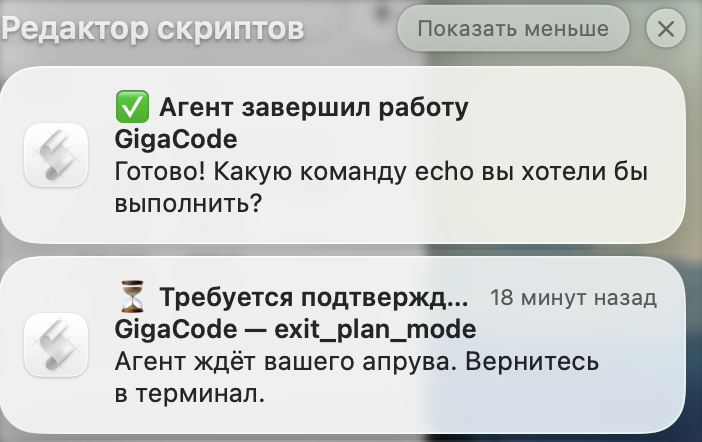

# GigaCode Notify Plugin 🔔

macOS уведомления для gigacode-cli.

При параллельной работе нескольких агентов получай уведомления когда:
- ⏳ Агент ждёт **апрува**
- ✅ Агент **завершил** работу
- ❌ Произошла **ошибка**

---

## Пример


---

## Требования

- `python3` должен стоять на маках по умолчанию.
- `gigacode --experimental-hooks` команда запуска.
- `Редактор скриптов` допуск к уведомлениям.


---
## Запуск
Если нету alias
```bash
gigacode --experimental-hooks
```
Если есть алиас в `~/.zshrc`:
```bash
gigacode
```

---

## Установка

Копируем папку `gigacode-notify` в любую директорию.
Переходим в папку:

```bash
cd gigacode-notify
```
Запускаем установку.
Пропишет пути и хуки в settings json и создаст фукнцию gigacode чтобы не писать каждый раз `gigacode --experimental-hooks`
```bash
./install.sh
```

---

### Добавить переменные руками если отказались при установке
Добавить функцию в `~/.zshrc` если хотите сохранить название команды `gigacode`, то лучше функция ,а не алиас.
Одна команда:
```bash
echo '
# >>> gigacode-notify >>>
gigacode() {
  command gigacode --experimental-hooks "$@"
}
# <<< gigacode-notify <<<' >> ~/.zshrc
```

Или добавить как обычный алиас в `~/.zshrc` то могут быть рекурсии, лучше дать другое название.
Например `gigahooks`, я у себя использую алиас одной буквой `g`:
```bash
alias gigahooks='gigacode --experimental-hooks'
```